<h1 align="center">bindview</h1>

<p align="center">
  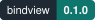 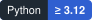
  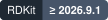 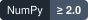
  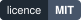
</p>

<p align="center">
  <b>Publication-quality figures of molecular interactions:<br>small molecules, peptides, RNA, DNA and proteins, from one structure to an ensemble.</b><br>
  A structure in, one SVG out. Python and command line.
</p>

<p align="center">
  <a href="#install">Install</a> · <a href="#quick-start">Quick start</a> · <a href="#figures">Figures</a> ·
  <a href="docs/manual.md">Manual</a> · <a href="docs/api.md">API</a> · <a href="docs/reference.md">Reference</a>
</p>

- **Every contact ends on what makes it**: a halogen bond on its fluorine, stacking on the ring, a salt bridge at the charged group.
- **Honest about the model**: pLDDT, PAE and shares of an ensemble are drawn into the figure, or stay out when the file does not declare them.
- **Legible or refused**: nothing overlaps, and the smallest text is checked against the page you print on.
- **Yours to change**: every place, colour and setting; by its words, or by dragging in a browser.

## Install

```bash
git clone https://github.com/jakob-steuer/bindview && cd bindview
pip install .                     # RDKit and NumPy, nothing else
```

Python 3.12 or newer, tested on 3.12 on macOS and Linux. Detecting contacts with [PLIP](https://github.com/pharmai/plip)
is optional and GPL-2.0 (`pip install ".[plip]"`). Without it, bindview makes a plain table of contacts itself, or
draws the one you give it.

## Quick start

```python
from bindview import Diagram

dia = Diagram.from_structure(
    "testdata/egfr_osimertinib/model.cif.gz", ligand="YY3",   # a residue name, "chain:number", or a peptide's chain
    smiles="Cn1cc(c2c1cccc2)c3ccnc(n3)Nc4cc(c(cc4OC)N(C)CCN(C)C)NC(=O)C=C",
    interactions="distances",                     # or a table, a list of records, or None to detect with PLIP
    covalent=True)                                # the bond to Cys797 that the file declares
dia.render_svg("osimertinib.svg")
```

The same from the command line:

```bash
bindview render testdata/egfr_osimertinib/model.cif.gz --ligand YY3 --distances-only --covalent -o osimertinib.svg \
    --smiles "Cn1cc(c2c1cccc2)c3ccnc(n3)Nc4cc(c(cc4OC)N(C)CCN(C)C)NC(=O)C=C"
```

Not sure what is in a file? `bindview report testdata/kit_imatinib -o report.html` looks, draws every figure the input
has, and prints the call under each.

## Figures

The code under each picture draws it from the root of the repository (here without its words: `bare=True`). A figure
of the library, opened by a click, answers the pointer. `case` reads a folder of [`testdata`](testdata): a PDB entry,
its ligand's SMILES, and the contacts that PLIP found.

<!-- runs -->
```python
import json, sys
from bindview import (BasePairs, Comparison, Diagram, Interface, Structure, read_rnapolis_pairs,
                      read_rnapolis_stacks, read_structure)
from bindview.distance_table import interface_contacts

def case(slug, model=None, interactions=None, **options):
    folder = f"testdata/{slug}"
    lig = json.load(open(f"{folder}/meta.json"))["ligand"]
    return Diagram.from_structure(model or f"{folder}/model.cif.gz", lig["residue_name_in_cif"], lig["smiles"],
                                  interactions or f"{folder}/interactions.tsv", name=lig["name"], **options)
```

### A ligand in its pocket

<table><tr>
<td width="50%" align="center" valign="top"><a href="docs/images/readme/detailed.live.svg?raw=true"><picture><source media="(prefers-color-scheme: dark)" srcset="docs/images/readme/detailed.dark.svg">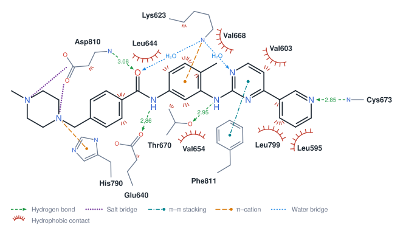</picture></a><br><b>Detailed</b><br><sub>the atoms that make the contacts</sub></td>
<td width="50%" align="center" valign="top"><a href="docs/images/readme/schematic.live.svg?raw=true"><picture><source media="(prefers-color-scheme: dark)" srcset="docs/images/readme/schematic.dark.svg">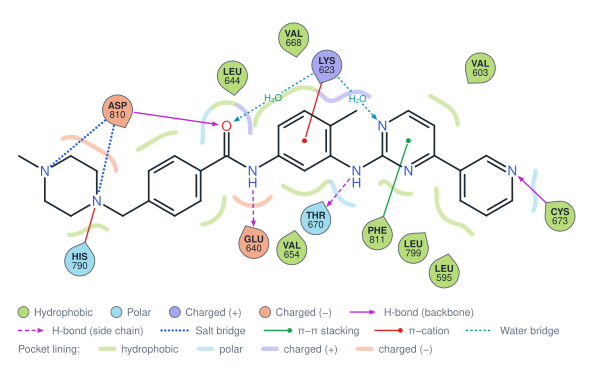</picture></a><br><b>Schematic</b><br><sub>residues as bubbles, the pocket lined by its contacts</sub></td>
</tr></table>

<!-- draws: detailed schematic -->
```python
kit = case("kit_imatinib")                                  # imatinib in c-Kit (1T46)
kit.render()
kit.render(style="schematic")
```

### Confidence of a prediction

The repository holds no predicted complex with a ligand: these are two domains of an AlphaFold database model, with
its own pLDDT and predicted aligned error (PAE).

<table><tr>
<td width="50%" align="center" valign="top"><a href="docs/images/readme/pae.live.svg?raw=true"><picture><source media="(prefers-color-scheme: dark)" srcset="docs/images/readme/pae.dark.svg">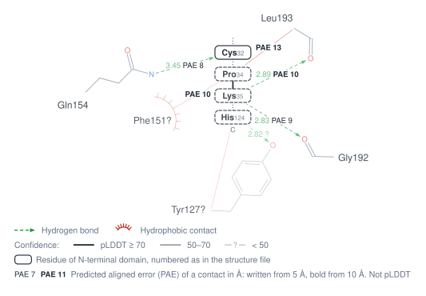</picture></a><br><b>PAE on the contacts</b><br><sub>written from 5 Å; pLDDT by line weight</sub></td>
<td width="50%" align="center" valign="top"><a href="docs/images/readme/plddt.live.svg?raw=true"><picture><source media="(prefers-color-scheme: dark)" srcset="docs/images/readme/plddt.dark.svg">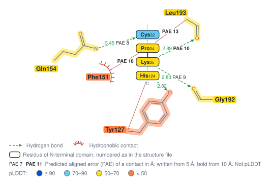</picture></a><br><b>pLDDT in AlphaFold's colours</b><br><sub>read only where the file declares it</sub></td>
</tr></table>

<!-- draws: pae plddt -->
```python
afdb = "testdata/interface_pae/afdb_tectb"                  # beta-tectorin, cut between its domains
model = read_structure(f"{afdb}/model.cif.gz").split("A", {"N": (28, 124), "Z": (126, 269)})
domains = Interface(model, ["N-terminal domain=N", "ZP domain=Z"], interface_contacts(model, ["N"], ["Z"]),
                    pae=f"{afdb}/predicted_aligned_error.json.gz")
domains.render()
domains.render(plddt_colors=True)
```

### Waters and ions

<table><tr>
<td width="50%" align="center" valign="top"><a href="docs/images/readme/water.live.svg?raw=true"><picture><source media="(prefers-color-scheme: dark)" srcset="docs/images/readme/water.dark.svg">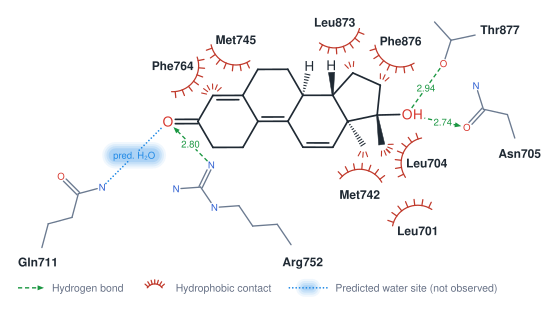</picture></a><br><b>Predicted water</b><br><sub>marked as predicted, in a model without waters</sub></td>
<td width="50%" align="center" valign="top"><a href="docs/images/readme/ion.live.svg?raw=true"><picture><source media="(prefers-color-scheme: dark)" srcset="docs/images/readme/ion.dark.svg">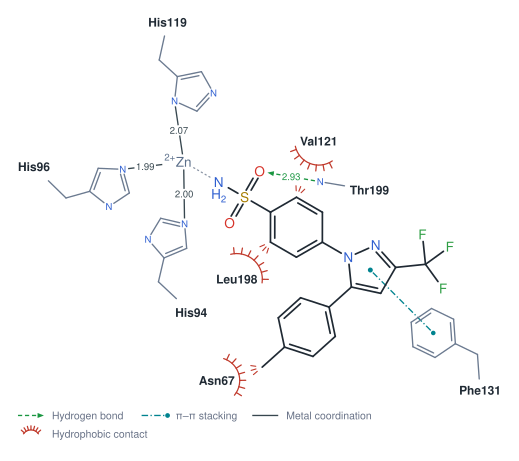</picture></a><br><b>An ion that bridges</b><br><sub>celecoxib on the zinc of carbonic anhydrase II</sub></td>
</tr></table>

<!-- draws: water ion -->
```python
r1881 = read_structure("testdata/ar_r1881/model.cif.gz")    # R1881 in the androgen receptor (2AO6)
dry = Structure([a for a in r1881.atoms if a.resname != "HOH"])        # its crystal waters taken out
case("ar_r1881", dry, "distances").render(solvent_sites=True)
case("ca2_celecoxib", ions=True).render()                    # 1OQ5
```

### The pocket in 3D

A sketch: [`prototype/ppi_openbook`](prototype/ppi_openbook), not part of the package.

<table><tr>
<td width="50%" align="center" valign="top"><a href="docs/images/readme/opened.svg">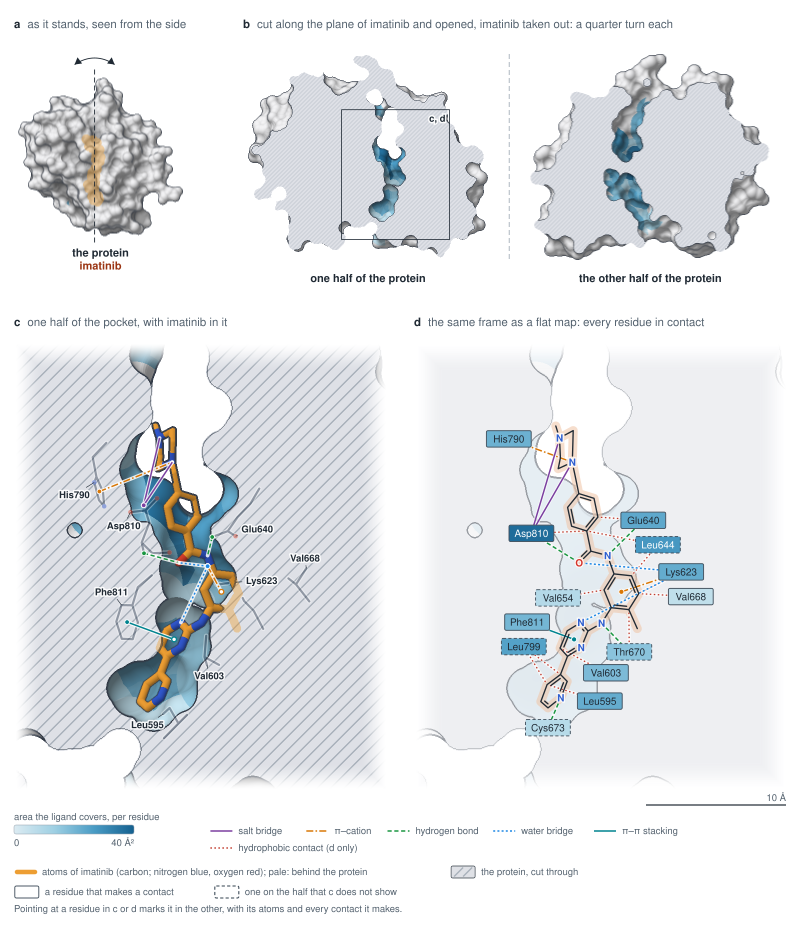</a><br><b>Opened like a book</b><br><sub>the ligand, both halves of the pocket, and a flat map</sub></td>
<td width="50%" align="center" valign="top"><a href="docs/images/readme/enclosed.svg">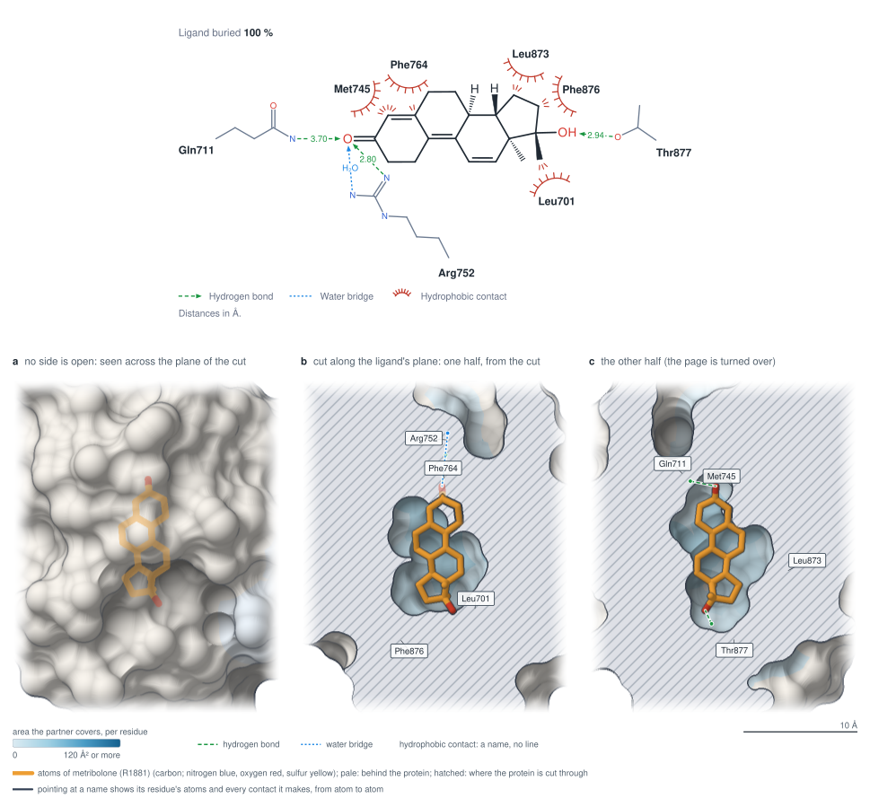</a><br><b>An enclosed ligand</b><br><sub>cut along its own plane</sub></td>
</tr></table>

<!-- draws: opened enclosed -->
```python
sys.path.insert(0, "prototype/ppi_openbook")
import ligandbook, pocket

ligandbook.panels(kit)
pocket.figure(case("ar_r1881"))
```

### Several ligands

<table><tr>
<td width="50%" align="center" valign="top"><a href="docs/images/readme/difference.live.svg?raw=true"><picture><source media="(prefers-color-scheme: dark)" srcset="docs/images/readme/difference.dark.svg">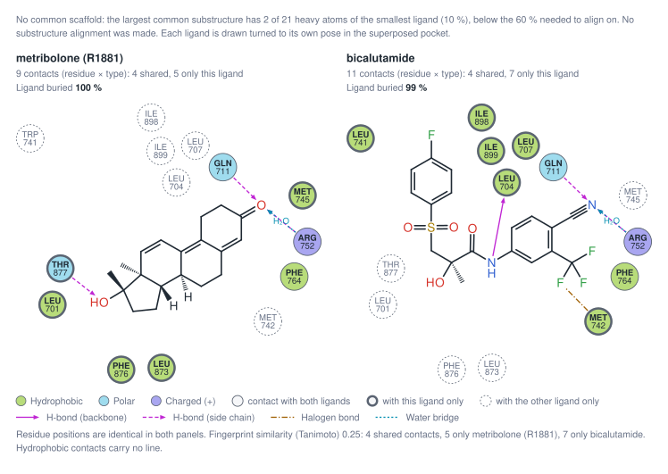</picture></a><br><b>What differs</b><br><sub>a steroid and bicalutamide on one frame of residues</sub></td>
<td width="50%" align="center" valign="top"><a href="docs/images/readme/several.svg?raw=true">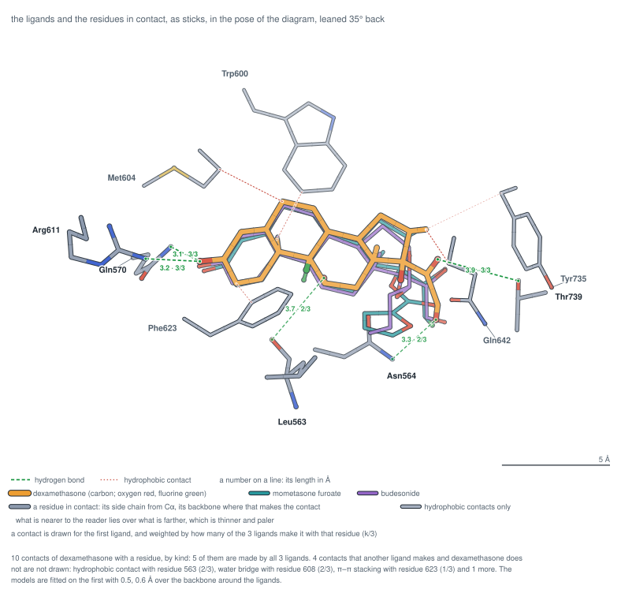</a><br><b>In 3D (a sketch)</b><br><sub>three corticosteroids in one pocket, and what they share</sub></td>
</tr></table>

<!-- draws: difference several -->
```python
Comparison([case("ar_r1881"), case("ar_bicalutamide")]).render(view="difference")

import interact3d
interact3d.several([case(s) for s in ("gr_dexamethasone", "gr_mometasone", "gr_budesonide")])
```

### A trajectory

<table><tr>
<td width="50%" align="center" valign="top"><a href="docs/images/readme/trajectory.live.svg?raw=true"><picture><source media="(prefers-color-scheme: dark)" srcset="docs/images/readme/trajectory.dark.svg">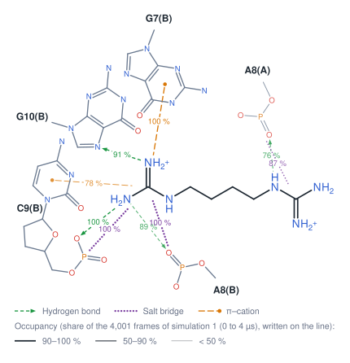</picture></a><br><b>One frame, with the shares of all</b><br><sub>each contact with the share of 4,001 frames that make it</sub></td>
</tr></table>

<!-- draws: trajectory -->
```python
sys.path.insert(0, "prototype/md_occupancy")      # bindview reads no trajectory: a sketch counts the contacts
import occupancy

md = occupancy.load("testdata/md/riboswitch_bisguanidine/simulation_1.json")
frames = md.state("all")
Diagram.from_structure(frames.frame, "BGD", md.smiles, frames.records, ensemble=frames.of).render()
```

### RNA and DNA

<table><tr>
<td width="50%" align="center" valign="top"><a href="docs/images/readme/rna.live.svg?raw=true"><picture><source media="(prefers-color-scheme: dark)" srcset="docs/images/readme/rna.dark.svg">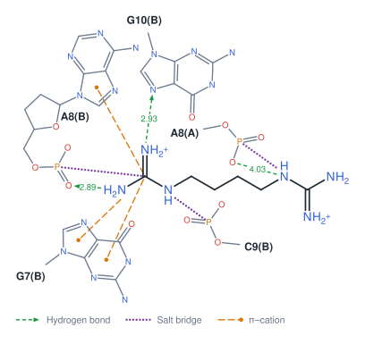</picture></a><br><b>A ligand in RNA</b><br><sub>a riboswitch, down to its bases</sub></td>
<td width="50%" align="center" valign="top"><a href="docs/images/readme/basepairs.live.svg?raw=true"><picture><source media="(prefers-color-scheme: dark)" srcset="docs/images/readme/basepairs.dark.svg">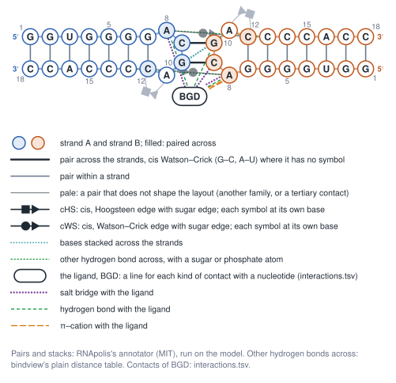</picture></a><br><b>Base pairs</b><br><sub>two hairpins, and the ligand between their loops</sub></td>
</tr></table>

<!-- draws: rna basepairs -->
```python
folder = "testdata/nucleic/riboswitch_bisguanidine"
model = read_structure(f"{folder}/model.pdb")
smiles = json.load(open(f"{folder}/meta.json"))["ligand"]["smiles"]
Diagram.from_structure(model, "BGD", smiles, f"{folder}/interactions.tsv").render()

found = f"{folder}/basepairs.rnapolis.json"
BasePairs(model, ["A", "B"], read_rnapolis_pairs(found), stacks=read_rnapolis_stacks(found),
          contacts=interface_contacts(model, ["A"], ["B"], stacking=True),
          ligand="BGD", ligand_contacts=f"{folder}/interactions.tsv").render()
```

### Peptides and proteins

Sketches. The package itself draws a peptide as a chain of its residues, and two chains with `Interface`.

<table><tr>
<td width="50%" align="center" valign="top"><a href="docs/images/readme/groove.svg">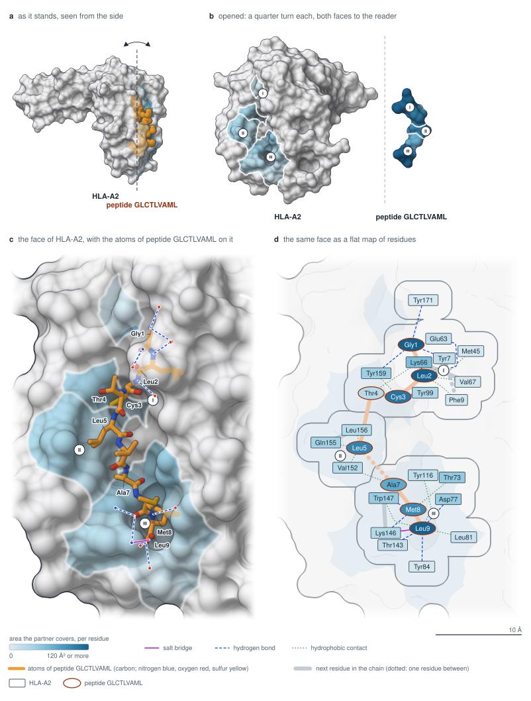</a><br><b>A peptide in its groove</b><br><sub>HLA-A2 with a nonamer (3MRE), opened like a book</sub></td>
<td width="50%" align="center" valign="top"><a href="docs/images/readme/regions.svg">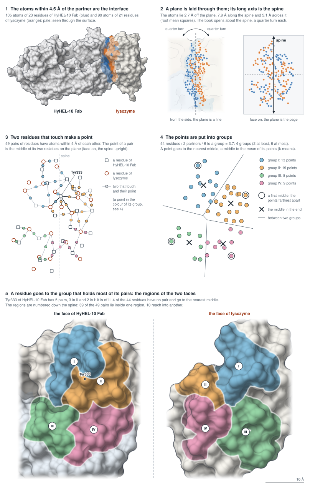</a><br><b>An interface in regions</b><br><sub>HyHEL-10 on lysozyme (3D9A), and how its regions are found</sub></td>
</tr></table>

<!-- draws: groove regions -->
```python
import book, openbook, regions

openbook.panels(book.load("testdata/mhc_peptide/model.cif.gz", ["A"], ["P"], names=("HLA-A2", "peptide GLCTLVAML")))
regions.figure(book.load("testdata/fab_lysozyme/model.cif.gz", ["H", "L"], ["C"], names=("HyHEL-10 Fab", "lysozyme")))
```

Also in the manual: [arranging by hand](docs/manual.md#arranging-by-hand) (`dia.arrange()`),
[residues a shorter construct lacks](docs/manual.md#residues-an-isoform-lacks),
[ensembles of models](docs/manual.md#several-models), [a page that drives its figures](docs/manual.md#figures-in-a-web-page),
[dark mode](docs/manual.md#colours-and-themes), [fingerprints as CSV](docs/manual.md#several-ligands).

## Where to look

| I want to … | |
|---|---|
| draw my first figure, pass in contacts, change its look | [Manual](docs/manual.md) |
| see every option and what it does | [API](docs/api.md), or `bindview.options()` in Python |
| know the rules, the thresholds and the limits | [Reference](docs/reference.md) |
| read or write a figure's layout as JSON | [Graph schema](docs/graph-schema.md) |
| draw from the command line | `bindview --help`, `bindview render --help` |

## Good to know

- Give the **SMILES** where you can: coordinates alone do not say which bond is double.
- A figure shows **what the model has**. It cannot know of a missing cofactor, partner chain or water.
- bindview computes **no score**. Thin lines mean weak support, not weak binding.
- `result.status` says how it went (`ok`, `empty`, `degraded`, `unreadable`) and `result.warnings` why, in words.

## Licence and citation

MIT ([LICENSE](LICENSE)). The core imports RDKit and NumPy (both BSD) and nothing else; one module imports PLIP, when
asked to. The test data are open: each folder says where it is from, and [NOTICE](NOTICE) names the work of others
in the repository. Cite with [CITATION.cff](CITATION.cff). Changes: [CHANGELOG.md](CHANGELOG.md).
