# Manual

How to do things with bindview, one task at a time. Every name and option is in [api.md](api.md), the rules, numbers
and limits are in [reference.md](reference.md), the layout graph is in [graph-schema.md](graph-schema.md). The examples
run in order from the root of the repository, on the files in `testdata/`, and write into the folder they are run from.

## The first figure

bindview needs Python 3.12 or newer (it is tested on 3.12, on macOS and Linux), RDKit and NumPy; `pip install .` in
the repository installs it and the command `bindview`. A figure needs a structure, the ligand in it, its SMILES and a
table of contacts:

```python
import json
from bindview import Diagram

meta = json.load(open("testdata/kit_imatinib/meta.json"))["ligand"]          # c-Kit with imatinib, PDB 1T46
dia = Diagram.from_structure("testdata/kit_imatinib/model.cif.gz", ligand="STI", smiles=meta["smiles"],
                             interactions="testdata/kit_imatinib/interactions.tsv", name="imatinib")
result = dia.render_svg("imatinib.svg")
print(result.status, result.warnings)          # ok []; see "Statuses" for "empty", "degraded", "unreadable"
```

```bash
bindview render testdata/kit_imatinib/model.cif.gz --ligand STI --smiles-from meta.json -o imatinib.svg
```

The command takes `interactions.tsv` from beside the structure where no table is given, and `--smiles-from` reads
the SMILES from a JSON file, here the `meta.json` beside the structure.

| what goes in | what it can be |
|---|---|
| the structure | mmCIF or PDB, gzipped or not: a path, or what `read_structure(path)` gives |
| the ligand | a residue name (`"STI"`), `"chain:number"`, `"chain:name:number"` (`"A:HEM:142"`), or the chain of a peptide or a strand (`"P"`) |
| its SMILES | the bond orders, which coordinates do not give reliably ([SMILES](#smiles)) |
| the contacts | a table's path, a list of records or dicts, `"distances"` ([plain table](#the-plain-distance-table)), `None` ([PLIP](#plip)); an empty list is "analysed, nothing found" |

`render()` gives the same result without writing a file: `result.svg`, `result.warnings` (what deviated from the
plain path, in words), `result.notes` (the words under the figure, for a caption of your own), `result.burial` (how
much of the ligand's surface the rest of the model covers). A diagram is built once and drawn as often as you like.

| `style="detailed"` (default) | `style="schematic"` | residue by residue |
|---|---|---|
| <picture><source media="(prefers-color-scheme: dark)" srcset="images/detailed.dark.svg">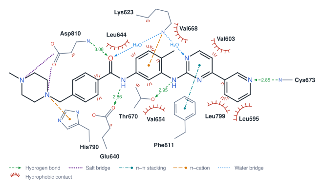</picture> | <picture><source media="(prefers-color-scheme: dark)" srcset="images/schematic.dark.svg">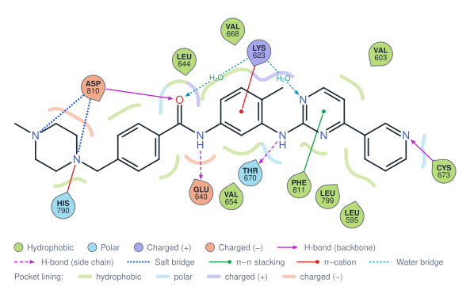</picture> | <picture><source media="(prefers-color-scheme: dark)" srcset="images/mixed.dark.svg">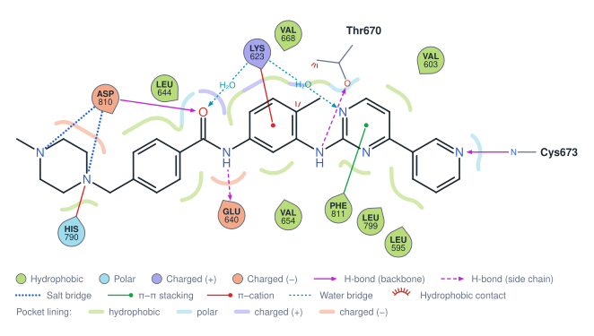</picture> |
| the atoms that make each contact | residues as bubbles, the pocket lined by its contacts | `residues={"Thr670": "atoms", "Cys673": "atoms", "*": "bubbles"}` |

## Tables of contacts

A table has a header and one contact a row. Fields are separated by tabs, commas or semicolons, whichever the header
has most of; spaces do not separate fields. `type` (or `interaction_type`), `residue_number` and `residue_name` are
required, and `chain` is needed where the number alone is not unique.

| column | what it holds |
|---|---|
| `type` | `hbond`, `saltbridge`, `hydrophobic`, `pi_stacking`, `pi_cation`, `halogen`, `metal`, `water_bridge`, `covalent` |
| `chain`, `insertion_code` | the residue as the structure file names it |
| `protein_atom`, `ligand_atom` | atom names as in the file; empty for a contact made by a ring or a charged group |
| `protein_atoms`, `ligand_atoms` | the atoms of that ring or group, with commas between them, where they are known |
| `distance`, `angle`, `ligand_is_donor`, `water` | ångström, degrees, the direction of a hydrogen bond, the bridging water (`A:1105`) |
| `occupancy`, `confidence`, `pae` | a share of an ensemble (0 to 1), a pLDDT (0 to 100), a predicted aligned error |

Where a ring or a charged group has no atom names, bindview finds the one whose distance fits. A row that cannot be
attached is not drawn, and the result is `degraded` and says which. An empty cell, `?`, `.`, `None` or `NA` is a value
that is not given. `load_interactions(path)` reads a file and `parse_interactions(text)` text; a list of dicts, such as
the rows of a database, is taken as it is:

```python
from bindview import parse_interactions

rows = parse_interactions("type;residue_number;residue_name;chain;protein_atom;ligand_atom;distance\n"
                          "hbond;640;GLU;A;OE1;N21;2.86\n"
                          "hbond;673;CYS;A;N;N3;2.85\n"
                          "pi_stacking;811;PHE;A;;;4.84\n")
print(Diagram.from_structure("testdata/kit_imatinib/model.cif.gz", "STI", meta["smiles"], rows).render().status)
```

## PLIP

[PLIP](https://github.com/pharmai/plip) detects contacts with hydrogens placed, angles and water bridges. It is
optional and under the GPL-2.0: `pip install ".[plip]"`. `interactions=None` asks for it; where it is not installed
the call raises `DetectionUnavailableError`, whose message says what to do instead:

```python
from bindview import DetectionUnavailableError

try:
    Diagram.from_structure("testdata/kit_imatinib/model.cif.gz", "STI", meta["smiles"])       # needs PLIP
except DetectionUnavailableError as error:
    print(error)
```

`bindview render` runs PLIP where no table is given and none lies beside the structure; `--detect` runs it even where
one does. This needs PLIP (the same without it: `--distances-only`, below):

```bash
bindview render testdata/kit_imatinib/model.cif.gz --ligand STI --smiles-from meta.json --detect -o detected.svg
```

For a ligand in RNA or DNA, PLIP has to be told that the nucleic acid is the receptor:
`bindview.detect.detect_interactions(structure, ligand, receptor="nucleic")`. A table written once where PLIP is
installed can be passed from then on; `scripts/case_tables.py` writes those of `testdata/`.

## The plain distance table

`interactions="distances"` (`--distances-only`) makes a table from the positions of the heavy atoms, with nothing else
installed. It is cruder than PLIP: no hydrogen is placed, so a hydrogen bond has no angle, and there are no water
bridges ([reference.md](reference.md) has the criteria). The tables are in `bindview.distance_table`:
`ligand_contacts` for a ligand of one residue, `contact_table` for a chain, `interface_contacts` between chains.
`as_tsv` writes the rows of the first as the text of a table, to keep or to read with `load_interactions`.

```python
from pathlib import Path
from bindview import read_structure
from bindview.distance_table import as_tsv, ligand_contacts

plain = Diagram.from_structure("testdata/kit_imatinib/model.cif.gz", "STI", meta["smiles"], "distances")
print(sorted({c.type.value for c in plain.interactions}))     # hbond, hydrophobic, pi_cation, pi_stacking
kit = read_structure("testdata/kit_imatinib/model.cif.gz")
Path("imatinib.plain.tsv").write_text(as_tsv(ligand_contacts(kit, "STI", meta["smiles"])))
```

```bash
bindview render testdata/kit_imatinib/model.cif.gz --ligand STI --smiles-from meta.json --distances-only -o plain.svg
```

## SMILES

A structure file gives positions, not bond orders. The SMILES gives them, laid on the atoms of the model; acids are
drawn ionised (`ionize_acids=False`, `--no-ionize`, keeps them as written). Without a SMILES the file's own is used
where it has one (AlphaFold 3 writes it); otherwise bond orders come from hydrogens in the model, and without those
only the connectivity is drawn, every bond single, and the status is `degraded`. `--smiles-from` reads `ligand.smiles`
or `smiles` of a JSON file.

A SMILES that cannot be laid on the model is refused with `LigandBuildError`, and the message says why. The PDB's
SMILES of the haem, which bonds the iron like any other atom, is one:

```python
from bindview import LigandBuildError

HAEM = "Cc1c2n3c(c1CCC(=O)O)C=C4C(=C(C5=[N]4[Fe]36[N]7=C(C=C8N6C(=C5)C(=C8C)C=C)C(=C(C7=C2)C)C=C)C)CCC(=O)O"
try:
    Diagram.from_structure("testdata/hb_carbon_monoxide/model.cif.gz", "A:HEM:142", HAEM, "distances")
except LigandBuildError as error:
    print(error)
haem = Diagram.from_structure("testdata/hb_carbon_monoxide/model.cif.gz", "A:HEM:142", interactions="distances")
print(haem.render().status)                                   # degraded: the connectivity alone
```

When a SMILES is refused, check that it is the molecule as modelled (its protonation, atoms the model lacks, a group
lost on binding), read what the message says of a metal, or draw without it and say so in the caption.

## Peptides and nucleic acids as chains

A ligand with a chain of eight amino-acid residues or more, or of three nucleotides or more, is drawn as a chain of
boxes, one a residue; what is not a residue (a lipid, a cap) is drawn as atoms on the residue that carries it. A chain
of its own in the file is named by its chain, and `"distances"` then makes its table with `contact_table`; without a
table it goes to PLIP's peptide mode. `ligand_as="atoms"` or `"chain"` overrules the choice.

```python
hirudin = Diagram.from_structure("testdata/thrombin_hirudin/model.cif.gz", "H", interactions="distances")
print(hirudin.backend.kind)                                   # chain
batch = hirudin.render(style="schematic", effort="quick", on_unreadable="none")
```

A long chain in a narrow groove may not fit the page: the result is then `unreadable`. In a batch, `effort="quick"`
gives up such a chain sooner and `on_unreadable="none"` draws nothing (`result.svg` is `None`, the reason is in
`result.warnings`). A strand of RNA as the ligand takes the protein chains as its partners, and ring stacking is in
the plain table where it is asked for:

```python
from bindview.distance_table import contact_table

u1a = read_structure("testdata/u1a_rna/model.cif.gz")                          # U1A on an RNA hairpin, PDB 1URN
hairpin = Diagram.from_structure(u1a, "P", interactions=contact_table(u1a, "P", partners=["A"], stacking=True))
riboswitch = "testdata/nucleic/riboswitch_bisguanidine"                        # a small molecule in RNA
bgd = json.load(open(f"{riboswitch}/meta.json"))["ligand"]
in_rna = Diagram.from_structure(f"{riboswitch}/model.pdb", "BGD", bgd["smiles"], f"{riboswitch}/interactions.tsv")
```

| a ligand in RNA | two strands and their base pairs |
|---|---|
| <picture><source media="(prefers-color-scheme: dark)" srcset="images/rna.dark.svg">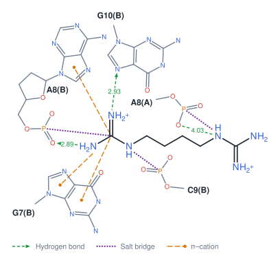</picture> | <picture><source media="(prefers-color-scheme: dark)" srcset="images/basepairs.dark.svg">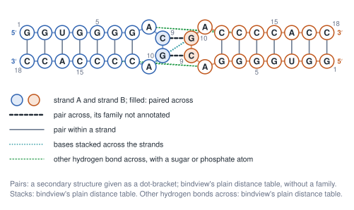</picture> |

## Interfaces, PAE and ipSAE

`Interface` draws the contacts between two chains, or two parts of a complex: the residues of one side as a column of
boxes, those of the other around them. The contacts are a table with both sides (`interface_contacts` makes the plain
one), or PLIP's. The predicted aligned error of a contact is written on its line from 5 Å, in bold from 10 Å;
`ipsae=True` adds ipSAE, a score of the interface as a whole, in both directions.

```python
from bindview import Interface
from bindview.distance_table import interface_contacts
from bindview.interface import dump_interface_contacts

tnf = "testdata/interface_multimer/tnfa_trimer"                                # TNF-alpha, three chains predicted together
trimer = read_structure(f"{tnf}/hTNFA_canonical_trimer_model_0.cif")
face = Interface(trimer, ["A", "B"], interface_contacts(trimer, ["A"], ["B"]),
                 pae=f"{tnf}/pae_hTNFA_canonical_trimer_model_0.npz", ipsae=True)
face.render_svg("tnf.svg", style="schematic")
Path("tnf_ab.tsv").write_text(dump_interface_contacts(interface_contacts(trimer, ["A"], ["B"])))    # for the command
fah = read_structure("testdata/interface_pae/afdb_fah/model.cif.gz").split("A", {"N": (18, 115), "C": (123, 412)})
domains = Interface(fah, ["N", "C"], interface_contacts(fah, ["N"], ["C"]),     # two domains of one chain
                    pae="testdata/interface_pae/afdb_fah/predicted_aligned_error.json.gz")
```

`bindview interface` takes a table with `--contacts`, as written above, or runs PLIP without one:

```bash
bindview interface testdata/interface_multimer/tnfa_trimer/hTNFA_canonical_trimer_model_0.cif --between A B \
    --contacts tnf_ab.tsv --pae testdata/interface_multimer/tnfa_trimer/pae_hTNFA_canonical_trimer_model_0.npz \
    --ipsae -o tnf.svg
```

A chain can be named by the protein it is. `chain_of` gives the chain that an mmCIF file assigns to a UniProt accession
(`_struct_ref`, which entries of the PDB and models of the AlphaFold database have). An accession of no chain or of
several, the copies of a homodimer, is an error, never a guess; `chains_of` lists them all.

```python
hb = read_structure("testdata/hb_carbon_monoxide/model.cif.gz")
alpha, beta = hb.chain_of("P69905"), hb.chain_of("P68871")                     # "A", "B"
Interface(hb, [alpha, beta], interface_contacts(hb, [alpha], [beta])).render_svg("hb.svg")
```

A PAE file is AlphaFold 3's `confidences.json`, Boltz's `pae_*.npz` or the AlphaFold database's file, of one chain or of
a complex; several draws of one model (`--pae` repeated, or a list) give the median of each contact. `pae_colors=True` draws the PAE as a glow
behind each line. `layout="auto"` draws the boxes where their residues lie when they come in several stretches of the
chain; `detail="sidechain"` draws the atoms of residues that make a directional contact.

## Base pairs

`BasePairs` draws two strands of RNA or DNA as their secondary structures facing each other, the pairs across with
their Leontis–Westhof symbols. The pairs are read, not detected: the PDB's annotation in a deposited mmCIF, RNA 3D
Hub's FR3D tables, the JSON of RNApolis's annotator, or a dot-bracket; without any, a stand-in from the plain table,
without a family.

```python
from bindview import BasePairs, read_mmcif_pairs

kissing = "testdata/rna_kissing/model.cif.gz"                                  # the HIV-1 kissing complex, PDB 1XPF
BasePairs(read_structure(kissing), ["A", "B"], read_mmcif_pairs(kissing)).render_svg("kissing.svg")
```

```bash
bindview basepairs testdata/rna_kissing/model.cif.gz --chains A B -o kissing.svg
bindview basepairs testdata/nucleic/riboswitch_bisguanidine/model.pdb --chains A B --ligand BGD \
    --pairs testdata/nucleic/riboswitch_bisguanidine/basepairs.rnapolis.json \
    --ligand-contacts testdata/nucleic/riboswitch_bisguanidine/interactions.tsv -o riboswitch.svg
```

The second draws the ligand between the nucleotides it touches. Without `--pairs` the command takes the file's own
annotation, else the stand-in; `--dot-bracket` gives a strand's own pairs.

## Confidence of a prediction

bindview draws the confidence a model states and computes none of its own.

| what | read from | not read |
|---|---|---|
| pLDDT of each atom | the B-factor column, only where the file declares it a pLDDT (`_ma_qa_metric`, as AlphaFold's mmCIF does) | B-factors, resolution or occupancy of a crystal structure; `_ma_qa_metric_local` |
| pLDDT you state | `plddt="bfactor"` (0 to 100), `"bfactor01"` (0 to 1), or `Confidence.from_values` | a scale is never guessed: values that cannot be on it are refused |
| ipTM, pTM, ranking score | AlphaFold 3's `summary_confidences.json` beside the model, or `model_confidence=` | pair ipTM |
| predicted aligned error | `pae=`: AlphaFold 3, Boltz, the AlphaFold database | Boltz's PDE, refused by name |
| your verdict | `trusted=False`, `flag="grade C"`: a banner across the figure | |

A contact is drawn at the lower pLDDT of its two ends. From 70 up nothing changes; from 50 to 70 lines and residues are
thinner and paler, below 50 more so and marked `?`. `plddt_colors=True` puts AlphaFold's four colours behind the atoms
instead, and `plddt_colors="bonds"` colours the bonds. A ligand diagram takes `pae=` too: each contact then stands on
a glow in the colour of its PAE. `render(confidence=False)` draws the plain figure.

| by line weight (default) | `plddt_colors="bonds"` |
|---|---|
| <picture><source media="(prefers-color-scheme: dark)" srcset="images/plddt_lines.dark.svg">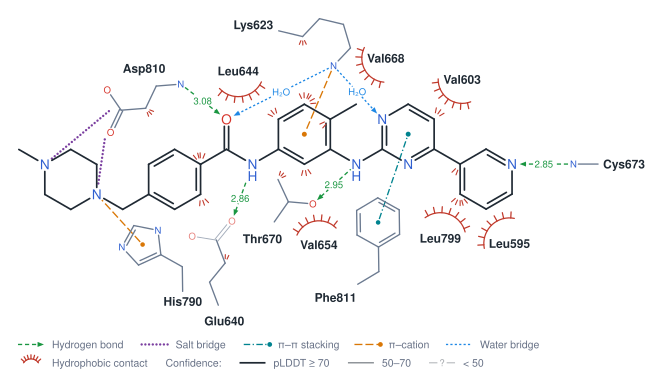</picture> | <picture><source media="(prefers-color-scheme: dark)" srcset="images/plddt_bonds.dark.svg">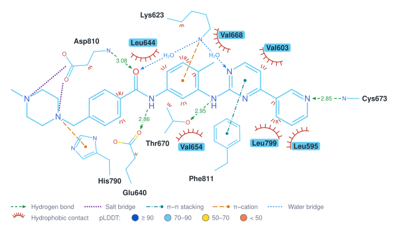</picture> |

Imatinib in c-Kit. A crystal structure has no pLDDT: the values of these two figures are made up to show the drawing
(100 less each atom's temperature factor). Values of your own are given as here:

```python
from bindview import Confidence

invented = Confidence.from_values({"A:640": 92, "A:670": 88, "A:673": 64, "A:810": 41}, {"N21": 55, "N13": 80})
shown = Diagram.from_structure("testdata/kit_imatinib/model.cif.gz", "STI", meta["smiles"],
                               "testdata/kit_imatinib/interactions.tsv", plddt=invented, flag="values invented")
print(shown.render(plddt_colors="bonds").confidence["contacts_by_band"])
```

## Covalent ligands, ions and waters

| `covalent=True` | `solvent_sites=True` |
|---|---|
| <picture><source media="(prefers-color-scheme: dark)" srcset="images/covalent.dark.svg">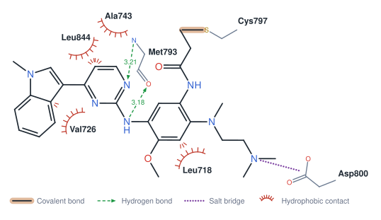</picture> | <picture><source media="(prefers-color-scheme: dark)" srcset="images/water.dark.svg">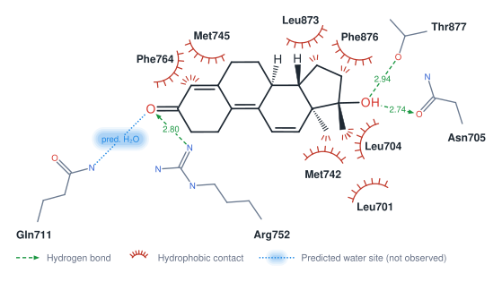</picture> |
| osimertinib bound to Cys797 of EGFR | R1881 in the androgen receptor, its waters taken out |

* `covalent=True` (`--covalent`) draws a bond between ligand and residue that the file declares or the distance shows,
  and draws the ligand as bound. A table can also bring rows of the kind `covalent`.
* `ions=True` (`--ions`) draws an ion that the model has between ligand and protein as the bridge it is. An ion can be
  the ligand itself, as the zinc below.
* Waters of the model reach the figure as `water_bridge` rows of the table. `solvent_sites=True` (`--solvent-sites`)
  predicts where a water could bridge, in a model without waters of its own, and marks each site as predicted; its
  footnote gives the numbers of a test on crystal structures. A structure with waters gets no prediction, and says so.

```python
from bindview import Structure

egfr = json.load(open("testdata/egfr_osimertinib/meta.json"))["ligand"]
osimertinib = Diagram.from_structure("testdata/egfr_osimertinib/model.cif.gz", "YY3", egfr["smiles"],
                                     "testdata/egfr_osimertinib/interactions.tsv", covalent=True)
print(osimertinib.render().warnings)                          # the bond to Cys797 SG, declared by the file
ca2 = json.load(open("testdata/ca2_celecoxib/meta.json"))["ligand"]
celecoxib = Diagram.from_structure("testdata/ca2_celecoxib/model.cif.gz", "CEL", ca2["smiles"],
                                   "testdata/ca2_celecoxib/interactions.tsv", ions=True)
zinc = Diagram.from_structure("testdata/ca2_celecoxib/model.cif.gz", "ZN", interactions="distances")
crystal = read_structure("testdata/ar_r1881/model.cif.gz")
dry = Structure(atoms=[a for a in crystal.atoms if a.resname != "HOH"])        # as a predicted model has it
r1881 = json.load(open("testdata/ar_r1881/meta.json"))["ligand"]
wet = Diagram.from_structure(dry, "R18", r1881["smiles"], "distances")   # (the crystal's table has its waters)
print(wet.render(solvent_sites=True).notes[-1])
```

## Several ligands

`Comparison` draws ligands of one pocket against one frame of residues: two give what differs, more what they share.
The residues do not move from panel to panel, so a difference between panels is one between ligands. Residues are
matched by chain and number, and the figure says whether the ligands share a scaffold to align on: a common
substructure that covers 60 % of the smallest ligand's heavy atoms or more (`Comparison(..., min_fraction=0.6)`,
`--min-fraction 0.6`).

```python
from bindview import Comparison

def case(slug):
    lig = json.load(open(f"testdata/{slug}/meta.json"))["ligand"]
    return Diagram.from_structure(f"testdata/{slug}/model.cif.gz", lig["residue_name_in_cif"], lig["smiles"],
                                  f"testdata/{slug}/interactions.tsv", name=lig["name"])

Comparison([case("ar_r1881"), case("ar_bicalutamide")]).render_svg("difference.svg")     # the androgen receptor
steroids = Comparison([case(s) for s in ("gr_dexamethasone", "gr_mometasone", "gr_budesonide")])   # three of the
steroids.table.to_csv("steroids.csv")                                          # glucocorticoid receptor: fingerprints
```

```bash
bindview compare testdata/ar_r1881/model.cif.gz testdata/ar_bicalutamide/model.cif.gz -o difference.svg
bindview fingerprint testdata/gr_dexamethasone/model.cif.gz testdata/gr_budesonide/model.cif.gz --form wide -o fp.csv
```

## Several models

`Ensemble` takes several models of one complex (samples of a prediction, an NMR bundle, frames written out as files)
with a table for each, or `"distances"` for all, and counts the models that make each contact. `read_models` gives
every model of one file.

```python
from bindview import Ensemble, read_models

AP5A = ("Nc1ncnc2n(cnc12)[C@@H]3O[C@H](COP(O)(=O)OP(O)(=O)OP(O)(=O)OP(O)(=O)OP(O)(=O)OC[C@H]4O[C@H]([C@H](O)"
        "[C@@H]4O)n5cnc6c(N)ncnc56)[C@@H](O)[C@H]3O")
samples = read_models("testdata/ensemble_bioemu2/ake_ap5a.pdb.gz")             # adenylate kinase, 20 samples
ens = Ensemble.from_structures(samples, "AP5", AP5A, "distances", ensemble="20 samples of BioEmu 2")
ens.consensus().render_svg("consensus.svg")       # all models in one figure, counted by residue
ens.diagram().render_svg("one_model.svg")         # one model, the share of the models on every contact
ens.to_csv("ensemble.csv")                        # every contact, its models, its distances
```

| `Ensemble.consensus()`: adenylate kinase with AP5A, 20 conformations sampled by BioEmu 2 |
|---|
| <picture><source media="(prefers-color-scheme: dark)" srcset="images/ensemble.dark.svg">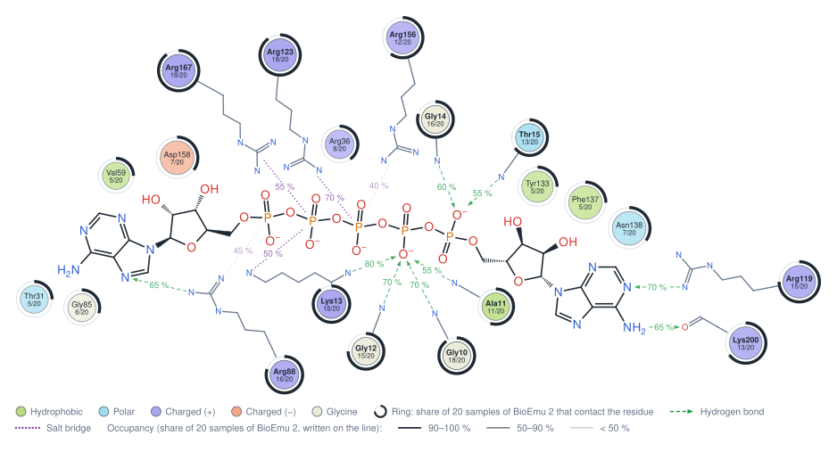</picture> |

In the consensus every residue stands in a ring as long as the share of the models that contact it; one that half of
them or more contact is drawn with atoms. A trajectory is counted elsewhere: give each row the share of the frames
that make it (`occupancy`), and say what that is a share of with `ensemble="1,000 frames"` (`--ensemble`).

## Residues an isoform lacks

A splice isoform, a construct, an orthologue: the same ligand in the same pocket, and residues the other protein does
not have. `absent=` takes their numbers or names (`"Leu799"`, `"A:799"`); those that touch the ligand are marked with
their contacts, and a sentence counts them. Nothing is computed for the other protein.

```python
marked = dia.render(absent=range(788, 830), absent_label="a shorter construct")
print(marked.notes[1])            # 4 of 13 contact residues are absent from a shorter construct.
faint = dia.render(absent=range(788, 830), absent_label="a shorter construct", absent_style="faint")
```

| `absent_style="marked"` (default) | `absent_style="faint"` |
|---|---|
| <picture><source media="(prefers-color-scheme: dark)" srcset="images/absent.dark.svg">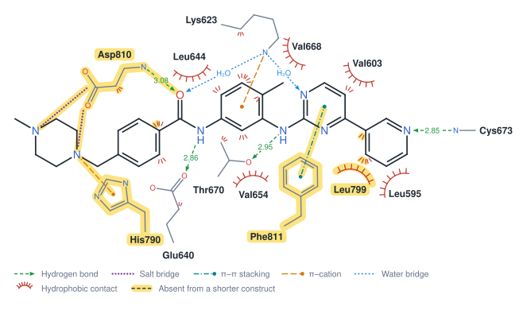</picture> | <picture><source media="(prefers-color-scheme: dark)" srcset="images/absent_faint.dark.svg">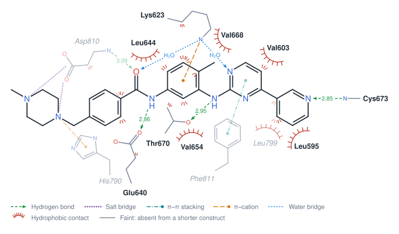</picture> |

On the command line: `--absent 788-829 --absent-label "a shorter construct"`. `result.data["absent"]` has both lists.
The figure with the mask lies on its page where the one without it does; only a drawing narrower than its key
(which wraps at 300 units) can be widened by the line the mask adds to the key.

## Styles and options

A style is a set of settings, and each can be set by hand in either style. `bindview.options()` prints every keyword of
`render` with its default; `bindview.options("legend")` those that mention a word.

| for | keywords of `render` |
|---|---|
| residues and lines | `residues` (`"atoms"`, `"bubbles"`, `"names"`, or by residue), `lines`, `lining`, `exposure`, `atom_labels`, `distance_labels`, `show_chain`, `break_lines`, `charge_halos`, `charge_key` |
| a web page | `interactive`, `stylesheet` |
| another protein | `absent`, `absent_label`, `absent_style` |
| colours and words | `colors`, `background`, `title`, `subtitle`, `legend`, `caption`, `notes`, `bare` |
| a predicted model | `confidence`, `plddt_colors`, `plddt_by_atom`, `pae_colors` |
| the pocket, an ensemble | `burial`, `solvent_sites`, `solvent_mark`, `occupancy_style`, `occupancy_labels` |
| size and legibility | `figure_width_mm`, `figure_height_mm`, `min_font_pt`, `on_unreadable`, `effort`, `bond_length`, `coords` |

```python
import bindview

print(bindview.options("legend"))
column = dia.render(style="schematic", distance_labels="all", bare=True, figure_width_mm=85, title="Imatinib in c-Kit")
```

A figure is legible when its smallest text prints at `min_font_pt` (5 pt) on a page of `figure_width_mm` by
`figure_height_mm` (180 by 240 mm). `bare=True` leaves the words around the drawing off; they stay in `result.notes`.
How much of a residue is drawn is chosen when the diagram is built: `detail="sidechain"` (`"box"`, `"backbone"`,
`"atoms"`).

## Colours and themes

`theme="dark"` draws for a dark page; `theme="auto"` puts both palettes into one file, which follows the reader's
setting. `colors="contrast"` (`--colors contrast`) is a second scheme, whose residue classes are further apart for every
kind of colour vision. A colour of your own is a `Palette`, handed in as the theme; it is one theme, light or dark.

```python
from bindview import DARK, LIGHT

dia.render(colors="contrast", theme="dark")
dia.render(theme=LIGHT.with_(hbond="#1f77b4", hydrophobic="#2ca02c"))
dia.render(theme=DARK.with_(hbond="#7fb8e6"), background=False)
```

A `Palette` handed in as the theme has no dark side: the figure is drawn in it alone, and `theme="auto"` is not
open to it. For colours of your own in both themes, register a scheme: a light and a dark palette in
`bindview.theme.SCHEMES`, under a name in lower case. `colors=` then takes that name as it takes `"contrast"`,
with every theme, `"auto"` too. `with_()` takes the names of the fields of `Palette` and refuses any other with a
`TypeError`, so a colour that a palette does not have is found where the scheme is registered.

```python
from bindview.theme import SCHEMES

SCHEMES["house"] = (LIGHT.with_(name="house", hbond="#1f77b4"), DARK.with_(name="house-dark", hbond="#7fb8e6"))
dia.render(colors="house", theme="auto")
```

## Figures in a web page

A figure that is part of the page (its text in the HTML, not an ``) can follow the page and the reader.
`interactive=True` makes it answer the pointer: a residue that is pointed at keeps its contacts and the rest steps back,
a bubble gives way to its atoms, an atom of the ligand says its contacts. It is a style sheet in the SVG and no script,
so as an image or in a drawing program the file is the plain figure. The page asks for the same with one attribute on
the `<svg>`: `data-active="640"` is what pointing at residue 640 is; residues and contacts carry
`data-residue-number`. With `theme="auto"` the figure follows `prefers-color-scheme`, or `data-theme="dark"` or
`"light"` on the `<svg>`.

A style sheet inside a figure speaks to the whole page. For several figures, leave it out of each and put it in the
page once (`stylesheet="scoped"` keeps it in the figure, for figures in the same colours alone):

```python
figures = [dia.render(theme="auto", interactive=True, stylesheet="external"),
           dia.render(style="schematic", theme="auto", interactive=True, stylesheet="external")]
page = f"<style>{bindview.stylesheet(figures)}</style>" + "".join(f.svg for f in figures)
Path("page.html").write_text(f"<!doctype html><meta charset='utf-8'><body>{page}</body>")
```

## Arranging by hand

The layout is data. `dia.arrange()` opens the figure in a browser, served on 127.0.0.1: drag a residue or the key;
with a residue picked, the wheel or <kbd>r</kbd> turns it, <kbd>f</kbd> flips it, the arrow keys nudge it, a double
click puts it back. bindview draws the figure again at each drop, so lines, labels and the lining follow; *Done* hands
the layout back. `dia.arrange("arrange.html")` writes the page as one file instead. The same by words:

```python
dia.arrange("arrange.html")
graph = dia.render().graph
graph.move("Leu595", 40, -30)       # right and down, in the units of the figure
graph.rotate("Thr670", 35)          # degrees, clockwise: a residue drawn with atoms
graph.flip("Glu640")
graph.move("legend", 0, 20)
arranged = dia.render(graph=graph, on_unreadable="render")
```

<picture><source media="(prefers-color-scheme: dark)" srcset="images/arranged.dark.svg">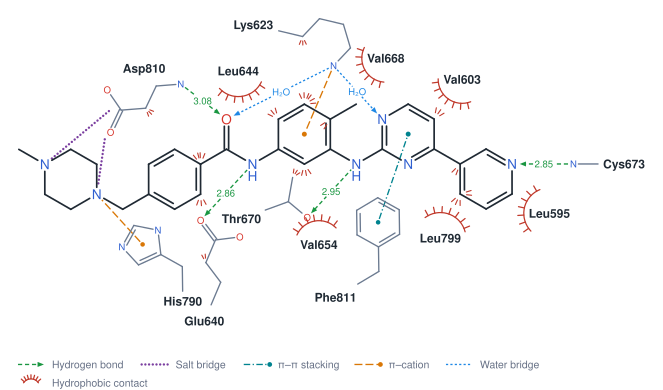</picture>

On the command line: `--arrange` (the browser), `--arrange-page arrange.html`, and `--layout` to draw from a layout
([Reproducing a figure](#reproducing-a-figure)). Where two things overlap after a move, `result.quality` says so.

## Reports

`bindview report` looks at a model, or a folder that holds one, says what it finds (chains, peptides, small molecules,
ions, waters, models) and draws a figure for each, under the call that drew it: copy the call and change it.

```bash
bindview report testdata/kit_imatinib -o report.html
bindview report testdata/interface_pae/afdb_tectb/model.cif.gz --domain N=A:28-124 --domain ZP=A:126-269 -o tectb.html
bindview report testdata/u1a_rna/model.cif.gz --look
```

A small molecule is drawn from a table beside the model, else with PLIP where it is installed, else from the plain
table; a peptide and an interface from the plain table. `--each` draws each input of a folder of different complexes,
with an index as a page and a CSV. From Python: `bindview.report.survey(path)`, then `.draw()` and `.html()`.

## The command line

`bindview render` draws one ligand in its pocket, `interface` the contacts between two chains or parts, `basepairs` two
strands and their base pairs, `compare` ligands of one pocket; `fingerprint` writes contacts as CSV, and `report` what
an input holds as one page. Most keywords of Python are flags (`solvent_sites=True` is `--solvent-sites`, `distance_labels` is `--distances`,
`figure_width_mm` is `--width-mm`); `bindview COMMAND --help` lists them. `--json` prints status, warnings, notes and
the measures of the layout; `--notes-file` writes the notes one a line. Without `-o`, `render`, `interface` and
`basepairs` write the figure beside the structure. Exit status: 0 a figure was written, 3 it is not readable at that
size, 2 an error, said in one line.

## Statuses and what to do

| you see | it means | what to do |
|---|---|---|
| `ok` | the figure that was asked for | |
| `empty` | no contact: the figure says so and lists the residues within 4.5 Å | check the table and the ligand |
| `degraded` | drawn, with something left out or assumed: `result.warnings` says what | give a SMILES; mend the rows that could not be attached |
| `unreadable` | not legible at that size: a table of the contacts in its place | a wider page, `style="schematic"`, or `on_unreadable="render"` |
| `no SMILES was given and the structure file carries none` | bond orders from hydrogens, or none | pass `smiles=` |
| `DetectionUnavailableError` | PLIP was asked for and is not installed | a table, `"distances"`, or PLIP |
| `LigandNotFoundError` | the selection matches no residue, or several | name it by `"chain:number"` |
| `LigandBuildError` | the SMILES cannot be laid on the model | [SMILES](#smiles) |
| `InteractionError` | a row of the table is malformed; the message names its line | mend the table |
| `GraphError`, or a `ValueError` about the style | a layout made for another diagram, style or options | lay it out again |
| lines thin, pale and marked `?` | pLDDT below 50 at one end of the contact | nothing: it is what the model says |
| pLDDT values refused | values that cannot be on the scale stated (0 to 1 read as 0 to 100) | state the scale (`plddt="bfactor01"`) |
| a residue marked `†` | it lies outside the contact set you gave (`beyond_contact_set`) | |

Errors of bindview are `BindviewError`s, but for values refused as a `ValueError`. Nothing found is never an error.

## Reproducing a figure

The same input gives the same bytes on one platform with one release of RDKit. A layout kept as JSON is drawn again
without being laid out (`render(graph=...)`, `--layout`):

```python
from bindview import Graph

kept = dia.render()
kept.graph.to_json("imatinib.graph.json")
print(dia.render(graph=Graph.from_json("imatinib.graph.json")).svg == kept.svg)      # True
```

```bash
bindview render testdata/kit_imatinib/model.cif.gz --ligand STI --smiles-from meta.json -o imatinib.svg --graph imatinib.json
bindview render testdata/kit_imatinib/model.cif.gz --ligand STI --smiles-from meta.json -o again.svg --layout imatinib.json
```

A layout belongs to one diagram, style and set of options. Write down `bindview.__version__` and `rdkit.__version__`
with a figure you will want to draw again.

## Environment and licence

bindview reads no environment variable and fetches nothing from the network; `arrange()` serves its page on 127.0.0.1
alone. Its core imports RDKit and NumPy (both BSD) and nothing else, under the MIT licence. PLIP (GPL-2.0) is imported
by `bindview.detect` alone, and only when a detection is asked for (`interactions=None`, `--detect`, a report without a
table). Install the `plip` extra and pass the combination on, and PLIP's terms apply to what you pass on; a caller
that brings its own tables runs no GPL code.
